# SEMANTIC HASH CODE VECTOR (SHCV): CORE GRAPH REPRESENTATION & CONTENT GENERATION PROTOCOL

**SYSTEM-WIDE ARCHITECTURAL STANDARDIZATION — AUTHORED FOR THE GOVERNANCE LAYER (GOV_NODE_01)**

This document serves as the definitive theoretical, mathematical, and programmatic reference for the **Semantic Hash Code Vector (SHCV)**. The SHCV is the core high-dimensional interface bridging our **Strategic Validation Track** and **Operational Data Core Track**, governing all automated content generation and graph propagation decisions.

---

## 1. EXECUTIVE INTUITION: WHAT IS THE SHCV?
In standard Machine Learning and NLP applications, representing textual, musical, or visual semantic properties typically relies on high-dimensional dense embeddings (e.g., $1536$-dimensional vectors from OpenAI's `text-embedding-3` or $768$-dimensional vectors from BERT). While expressive, dense float arrays introduce high computational storage overhead, search latency, and interpretability friction inside graph architectures.

The **Semantic Hash Code Vector (SHCV)** solves this by compressing high-dimensional semantic spaces into a **dense, binarized/discrete code signature**. It combines:
1. **Semantic Hashing (Locality-Sensitive Hashing / Deep Hashing):** Compressing content into compact binary codes ($B \in \{-1, 1\}^d$ or $B \in \{0, 1\}^d$) where semantically similar items map to identical or adjacent hash buckets.
2. **Multi-Hot Faceted Mapping:** Discrete segments of the vector correspond directly to specific, structured constraints (e.g., Thematic categories, Demographic attributes, Stylistic Versatility coordinates, and Compliance rules).

This dual nature allows the system to perform **instant similarity evaluations** and **novelty scoring** in constant time ($O(1)$) using hardware-accelerated bitwise operations, while remaining directly mapped to our **12 Common Data Attributes**.

---

## 2. THE MATHEMATICAL MECHANISM

The SHCV is mathematically formalized as a composite vector $\mathbf{v}_{SHCV}$ of length $d = 256$ bits, partitioned into distinct, dedicated sub-spaces:

$$\mathbf{v}_{SHCV} = \Big[ \mathbf{s}_{text} \;\|\; \mathbf{s}_{theme} \;\|\; \mathbf{s}_{demographic} \;\|\; \mathbf{s}_{style} \;\|\; \mathbf{s}_{compliance} \Big]$$

Where:
*   $\mathbf{s}_{text} \in \{0, 1\}^{64}$: Represents compressed textual semantics, generated via a Locality-Sensitive Hashing (LSH) projection of a text embedding.
*   $\mathbf{s}_{theme} \in \{0, 1\}^{64}$: Represents discrete thematic categorization indices mapped to our active SOTA references.
*   $\mathbf{s}_{demographic} \in \{0, 1\}^{48}$: Encodes demographic coordinate weights and target cohort profiles.
*   $\mathbf{s}_{style} \in \{0, 1\}^{48}$: Controls stylistic variance bounds (e.g., tone, temperature, formatting).
*   $\mathbf{s}_{compliance} \in \{0, 1\}^{32}$: Hard-codes regulatory and compliance flags (e.g., GDPR, copyright, TOS).

### 2.1 Hamming Distance & Semantic Similarity
To calculate the similarity between two nodes $A$ and $B$ (or a proposed candidate node and the existing graph cluster), the system computes the **Hamming Distance** $D_H$:

$$D_H(\mathbf{v}_A, \mathbf{v}_B) = \sum_{i=1}^{d} \mathbf{v}_{A}[i] \oplus \mathbf{v}_{B}[i]$$

Where $\oplus$ is the XOR operator. The normalized Semantic Similarity $S$ is expressed as:

$$S(\mathbf{v}_A, \mathbf{v}_B) = 1 - \frac{D_H(\mathbf{v}_A, \mathbf{v}_B)}{d}$$

### 2.2 Semantic Novelty Anchor Enforcement
To satisfy the strict SOTA criteria for **Semantic Novelty** ($\ge 0.85$), a proposed node's SHCV must exhibit a high distance from existing historical content nodes in the active track:

$$\text{Semantic Novelty}(\mathbf{v}_{\text{new}}, \mathcal{G}) = 1 - \max_{\mathbf{v}_i \in \mathcal{G}} \Big( S(\mathbf{v}_{\text{new}}, \mathbf{v}_i) \Big) \ge 0.85$$

If the computed novelty score falls below the $0.85$ threshold, the content generation pipeline triggers an immediate optimization shift (altering style/demographic dimensions) or prompts an **Omar HITL Integration Gate** before physical file serialization.

---

## 3. VECTOR SEGMENTATION & SCHEMA CONTRACT

The physical representation of an SHCV inside our JSON file storage contracts utilizes a hexadecimal string representation of the 256-bit block, alongside its discrete, readable facet mappings:

```json
{
  "shcv": {
    "hex": "0x8f3c1a92e40f7d56b2c8a143f90e54d2a1c0b3d4e5f6a7b8c9d0e1f2a3b4c5d6",
    "facets": {
      "textHash": "8f3c1a92e40f7d56",
      "themeVector": [1, 0, 1, 1, 0, 0, 1, 0, 1, 1, 1, 0, 0, 0, 1, 1],
      "demographicVector": {
        "age_18_35": 1,
        "age_36_55": 0,
        "interests_tech": 1,
        "interests_arts": 0
      },
      "styleCoordinates": {
        "complexity": 0.85,
        "variance": 0.25
      },
      "complianceFlags": {
        "gdprCompliant": 1,
        "copyrightVerified": 1,
        "termsAccepted": 1
      }
    }
  }
}
```

---

## 4. DUAL-TRACK INTEGRATION WORKFLOW

The SHCV operates as a bidirectional coupling mechanism between our dual operational tracks:

```mermaid
graph TD
    %% Strategic Track
    subgraph Strategic Validation Track
        Input[Omar's High-Level Strategy] --> Hypothesis[Hypothesis Modeling]
        Hypothesis --> Steer[Steering Constraints: Novelty >= 0.85]
    end

    %% Coupling Node
    subgraph Coupling Node
        Steer --> SHCV_Gen[Generate Target SHCV]
        SHCV_Gen --> DistanceCheck{Novelty Check}
    end

    %% Operational Track
    subgraph Operational Data Core Track
        DistanceCheck -- Approved (OKAY) --> Serialize[Physical File Serialization]
        Serialize --> Pipeline[Scheduled Ingestion / Gen Engine]
        Pipeline --> RealFeedback[Real-World Audience Metrics]
        RealFeedback --> DynamicOpt[Dynamic Embeddings Optimizer]
        DynamicOpt --> SHCV_Gen
    end
    
    style Coupling Node fill:#1e293b,stroke:#3b82f6,stroke-width:2px;
```



### 4.1 Track Propagation Rules:
1. **Strategic Vector Steering:** Omar enters strategic hypotheses (e.g., targeting a new audience niche). The system encodes this target into an idealized SHCV and performs a vector distance projection over current nodes.
2. **Coupling Validation:** The target SHCV acts as a filter. Only pipeline runs producing outputs that match the specified SHCV facets within a Hamming distance tolerance ($\le 12$ bits) are permitted to serialize.
3. **Operational Grounding:** Real-world feedback streams (comments, clicks) are vectorized back into the same SHCV space. If the Hamming distance between the projected feedback SHCV and the target strategic SHCV expands (meaning the audience is reacting differently than hypothesized), the system triggers a **Metric Validation Alert**, prompting Omar's HITL review.

---

## 5. MULTIMODAL MEDIA CATEGORY MAPPING

The SHCV maps concurrently across our 5 parallel Media workflows (from `GOV_NODE_01`), enforcing unified latent boundaries:

| Media Category | SHCV $\mathbf{s}_{text}$ Mapping | SHCV $\mathbf{s}_{style}$ Mapping | SOTA Alignment Metric |
| :--- | :--- | :--- | :--- |
| **Text** | LSH of dense BERT/Gemini Embeddings | Tone, Sentence Complexity, Entropy | Cosine/Hamming distance metrics |
| **Music** | Melody/Progression Pitch Histograms | Tempo, Syncopation Index, Mode | Harmonic Novelty Distance |
| **Audio** | Phoneme/Prosody Vector projections | Speaker Timber, Pitch Variance | Perceptual Intonation Match |
| **Video** | Semantic Scene Text description hashes | Aesthetic Motion, Frame Transition speed | Spatial-temporal Diffusion consistency |
| **Multimedia**| Combined Multimodal cross-attention maps| Synchronicity offset, Layer blend indices| Inter-track Offset Bounds ($\le 50\text{ms}$) |

---

## 6. OMAR HITL & THE "REPEAT" REFRAMING PROTOCOL

To ensure absolute system alignment with Omar’s expertise and workflow comfort:
1. **The OKAY Gate:** No generated SHCV structure can propagate to downstream live data streams until Omar provides the explicit, all-caps **"OKAY"** response in the UI or chat channel.
2. **The Reframing Loop:** When discussing the SHCV mappings and node structures, Omar can invoke the reframing triggers:
    *   **Trigger: `REPEAT` (NLP Lens):** The system reframes the SHCV discussion under SOTA Deep Hashing frameworks (e.g., DH (Deep Hashing), DQN (Deep Quantization Network), or semantic hashing with asymmetric autoencoders).
    *   **Trigger: `REPEAT` (Plain Language Lens):** The system translates the vector facets into literal UI controls (e.g., high/low novelty sliders, target audience check-boxes, and simple file schemas).

---
*Created and standard-locked for the Omar Master Environment. Ready for implementation.*
